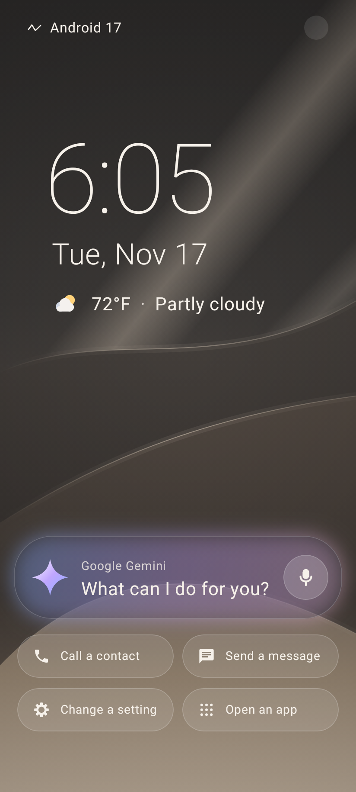
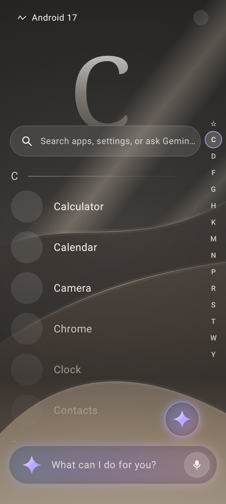

# AURA Launcher

A minimalist home screen for **Android 17**, with Google Gemini built into the home screen and an alphabet scroller that curves toward your finger.

| Home | App drawer | Lettered scroll |
|---|---|---|
|  |  |  |

<sub>These screenshots come from the JVM screenshot test using sample data. On a real phone, app icons, the Google logo and dock icons show up.</sub>

## Features

### Minimalist home
- A large thin clock, the date, and local weather from Open‑Meteo. Weather needs no API key and uses only your coarse location.
- The AURA backdrop: a charcoal sky, a diagonal shaft of warm light, and sand dunes with glowing ridges. You can switch to your system wallpaper in settings.
- A Gemini card above the dock, with nothing else in the way.
- A dock with your real default Phone, Messages, Browser, Photos and Camera apps.

### Gemini, built into the launcher
Gemini runs **inside AURA**. It never opens the Gemini app. Tap the Gemini card, the bar or the sparkle button, or ask from drawer search.

- **First use:** tap **Continue with Google**, pick your account and allow access. That's the only setup on the phone. After that, access tokens refresh silently in the background.
- **Voice:** the mic listens inline with live transcription. It uses on-device speech recognition when available and opens no dialog or other app.
- **Gemini acts on the phone** through function calling:

  | Tool | What it does |
  |---|---|
  | `open_app` | Opens any installed app, matched loosely by name |
  | `open_settings` | Opens Wi‑Fi, Bluetooth, volume, display, battery, NFC, DND, location and more (uses quick panels where available) |
  | `call_contact` | Looks up a contact and places the call (asks for the `CALL_PHONE` permission the first time) |
  | `send_message` | Opens a pre-filled SMS/RCS message. **You tap send** |
  | `set_alarm` / `set_timer` | Sets an alarm or timer silently in your clock app |
  | `set_flashlight` | Turns the torch on or off |
  | `navigate` | Starts turn‑by‑turn navigation |
  | `play_media` | Plays something by search in your music/video app |
  | `create_calendar_event` | Opens a pre-filled event draft |
  | `web_search`, `open_url`, `open_camera` | What they say |
  | `get_device_status` | Reads battery, charging, network, ringer and time |

#### One-time Google Cloud setup (developer)
Google sign-in calls the Gemini API with OAuth. The developer registers it once:

1. In [Google Cloud console](https://console.cloud.google.com), create or pick a project and **enable "Generative Language API"**.
2. Go to **Google Auth Platform → Branding** and fill in an app name and email. Under **Audience**, choose **External**, publishing status **Testing**, and add every Gmail that will sign in under **Test users**.
3. Go to **Clients → Create client → Android**:
   - Package name: `com.aura.launcher`
   - SHA-1: shown in **AURA settings → Google setup** (tap to copy). For builds signed with `keystore/aura-signing.keystore` it is
     `21:5E:10:55:71:4E:D8:77:73:F0:3C:85:73:0C:10:1A:FE:B4:96:D6`.
4. On the phone, tap **Continue with Google**. Google shows an "unverified app" notice while the project is in Testing; tap **Continue**.

Requested scopes: `generative-language.retriever` and `cloud-platform` (the pair Google documents for user-credential access to the Gemini API), plus `userinfo.email` to show who is signed in.

> Usage counts against your Cloud project's Gemini API quota (free tier, or billing if enabled). It does **not** use a consumer Gemini / Google One AI subscription, because Google doesn't let third-party apps use those.

**Advanced:** under Settings → Gemini → Advanced you can change the model (default `gemini-flash-latest`) or use an AI Studio API key instead of signing in.

### App drawer
- Swipe right from the left side of the screen; the drawer slides in from the left.
- A big serif watermark shows the current section letter (**M**, **G** and so on). The current section stays fully visible while sections further down fade out.
- One search bar covers apps, settings shortcuts, **Ask Gemini** and web search.
- **Lettered scroll animation**: press and drag the A–Z column on the right edge.
  - The letters bend into a curved arc that follows your finger.
  - A glowing bubble shows the selected letter, with a haptic tick on each change.
  - The drawer dims, and that letter's apps appear on the left, centered on the bubble.
  - Lift your finger to jump to the section, or slide left onto an app and lift to launch it.
  - ☆ at the top of the column holds your favorites and most-used apps.
- Long-press an app to add it to favorites, open App info, or uninstall it.
- Work-profile apps are included and badged.

### Gestures
| Gesture | Action |
|---|---|
| Swipe right from the left side | Open the app drawer |
| Swipe left / Back | Close the drawer |
| Tap the Gemini card / bar / sparkle | Open the Gemini panel |
| Mic button or long-press the card | Talk to Gemini |
| Long-press "Android 17" | AURA settings |
| Tap the clock / date / weather | Clock / Calendar / Weather |

## Requirements
- **Android 17 (API 37) only.** `minSdk` and `targetSdk` are both 37.
- Google Play services (for Google sign-in).

## Build

```bash
# Requires JDK 17+ and the Android SDK with platforms;android-37.0 + build-tools;37.0.0
./gradlew assembleDebug        # app/build/outputs/apk/debug/app-debug.apk
./gradlew assembleRelease      # minified; signed with the debug key for sideloading
./gradlew :app:testDebugUnitTest --tests '*ScreenshotTest*'   # renders app/build/screenshots/*.png
```

Install it with `adb install app/build/outputs/apk/debug/app-debug.apk`. Then press Home and pick **AURA**, or use **Settings → Set AURA as your home app**.

> Builds are signed with `keystore/aura-signing.keystore` when present (kept out of git, so back it up). Google sign-in is registered against its SHA-1, and it lets new builds install over old ones. Without it, Gradle falls back to your local debug key, and you'd need to register that SHA-1 too.

## Tech
Kotlin with Jetpack Compose and Material 3, AGP 9.5 and Gradle 9.9. There are no third-party runtime dependencies: Gemini and Open‑Meteo are called with the platform `HttpURLConnection` and `org.json`. Google sign-in uses Play services' `AuthorizationClient`. Apps are loaded through `LauncherApps`, so live package changes and work profiles are handled the same way the system launcher handles them.

```
app/src/main/java/com/aura/launcher/
├── MainActivity.kt, MainViewModel.kt, ActivityBridge.kt
├── data/      AppRepository (LauncherApps), AuraPrefs, Weather, settings & dock shortcuts
├── gemini/    GoogleAccountAuth (sign-in + tokens), AuraAgent (function-calling loop), PhoneTools
└── ui/        AuraRoot, HomeScreen, Drawer, AlphabetArc, GeminiSheet, SettingsScreen, Backdrop, Icons, Glass
```

## Privacy
- Nothing leaves the device unless you use Gemini (your prompt, installed app names and tool results go to Google's Gemini API, authorized by your Google sign-in) or weather (your coarse coordinates go to Open‑Meteo). Sign out in settings to revoke AURA's access.
- Calls need a runtime permission you grant. Messages and calendar events open as drafts for you to confirm.
