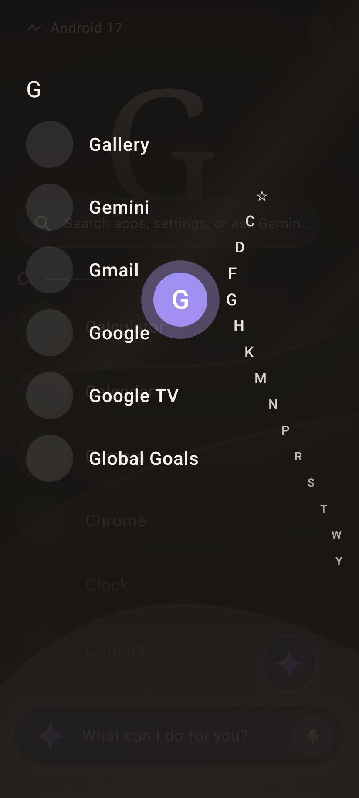

# AURA Launcher

A minimalist home screen for **Android 17**, with Google Gemini built into the home screen and an alphabet scroller that curves toward your finger.

| Home | App drawer | Lettered scroll |
|---|---|---|
|  |  |  |

<sub>These screenshots come from the JVM screenshot test using sample data. On a real phone, app icons, the Google logo and dock icons show up.</sub>

## Features

### Minimalist home
- A large thin clock, the date, and local weather from Open‑Meteo. Weather needs no API key and uses only your coarse location.
- The AURA backdrop: a charcoal sky, a diagonal shaft of warm light, and sand dunes with glowing ridges. You can switch to your system wallpaper in settings.
- A Gemini card above the dock, with nothing else in the way.
- A dock with your real default Phone, Messages, Browser, Photos and Camera apps.

### Gemini on the home screen
AURA gives you two ways to use Gemini (choose one in **Settings → Gemini**):

1. **Google Gemini app** (default). Typed prompts, voice and the sparkle button all go straight to the system Gemini app. If you make Gemini your default digital assistant (there's a shortcut in settings), it can read your screen and control apps across the whole phone.
2. **AURA agent (Gemini API)**. Gemini runs inside the launcher and uses *function calling* to operate the phone directly:
   | Tool | What it does |
   |---|---|
   | `open_app` | Opens any installed app, matched loosely by name |
   | `open_settings` | Opens Wi‑Fi, Bluetooth, volume, display, battery, NFC, DND, location and more (uses quick panels where available) |
   | `call_contact` | Looks up a contact and places the call (asks for the `CALL_PHONE` permission the first time) |
   | `send_message` | Opens a pre-filled SMS/RCS message. **You tap send** |
   | `set_alarm` / `set_timer` | Sets an alarm or timer silently in your clock app |
   | `set_flashlight` | Turns the torch on or off |
   | `navigate` | Starts turn‑by‑turn navigation |
   | `play_media` | Plays something by search in your music/video app |
   | `create_calendar_event` | Opens a pre-filled event draft |
   | `web_search`, `open_url`, `open_camera` | What they say |
   | `get_device_status` | Reads battery, charging, network, ringer and time |
   | `ask_gemini_app` | Hands harder requests to the full Gemini app |

   Get an API key at [aistudio.google.com](https://aistudio.google.com) and paste it in settings. The default model is `gemini-flash-latest`, and you can change it. The key is stored only on your device and is sent only to Google's Gemini API.

### App drawer
- Swipe right from the left side of the screen; the drawer slides in from the left.
- A big serif watermark shows the current section letter (**M**, **G** and so on). The current section stays fully visible while sections further down fade out.
- One search bar covers apps, settings shortcuts, **Ask Gemini** and web search.
- **Lettered scroll animation**: press and drag the A–Z column on the right edge.
  - The letters bend into a curved arc that follows your finger.
  - A glowing bubble shows the selected letter, with a haptic tick on each change.
  - The drawer dims, and that letter's apps appear on the left, centered on the bubble.
  - Lift your finger to jump to the section, or slide left onto an app and lift to launch it.
  - ☆ at the top of the column holds your favorites and most-used apps.
- Long-press an app to add it to favorites, open App info, or uninstall it.
- Work-profile apps are included and badged.

### Gestures
| Gesture | Action |
|---|---|
| Swipe right from the left side | Open the app drawer |
| Swipe left / Back | Close the drawer |
| Tap the Gemini card | Open the Gemini panel |
| Long-press the Gemini card | Open the full Gemini app |
| Mic button | Talk to Gemini |
| Sparkle button in the drawer | Gemini overlay (long-press for voice) |
| Long-press "Android 17" | AURA settings |
| Tap the clock / date / weather | Clock / Calendar / Weather |

## Requirements
- **Android 17 (API 37) only.** `minSdk` and `targetSdk` are both 37.
- For the best Gemini experience, install the Google Gemini app and set it as your default assistant.

## Build

```bash
# Requires JDK 17+ and the Android SDK with platforms;android-37.0 + build-tools;37.0.0
./gradlew assembleDebug        # app/build/outputs/apk/debug/app-debug.apk
./gradlew assembleRelease      # minified; signed with the debug key for sideloading
./gradlew :app:testDebugUnitTest --tests '*ScreenshotTest*'   # renders app/build/screenshots/*.png
```

Install it with `adb install app/build/outputs/apk/debug/app-debug.apk`. Then press Home and pick **AURA**, or use **Settings → Set AURA as your home app**.

> Before publishing anywhere, replace the debug signing config in `app/build.gradle.kts` with your own keystore.

## Tech
Kotlin with Jetpack Compose and Material 3, AGP 9.5 and Gradle 9.9. There are no third-party runtime dependencies: Gemini and Open‑Meteo are called with the platform `HttpURLConnection` and `org.json`. Apps are loaded through `LauncherApps`, so live package changes and work profiles are handled the same way the system launcher handles them.

```
app/src/main/java/com/aura/launcher/
├── MainActivity.kt, MainViewModel.kt, ActivityBridge.kt
├── data/      AppRepository (LauncherApps), AuraPrefs, Weather, settings & dock shortcuts
├── gemini/    GeminiBridge (system Gemini hand-off), AuraAgent (function-calling loop), PhoneTools
└── ui/        AuraRoot, HomeScreen, Drawer, AlphabetArc, GeminiSheet, SettingsScreen, Backdrop, Icons, Glass
```

## Privacy
- Nothing leaves the device unless you use the AURA agent (your prompt, installed app names and tool results go to Google's Gemini API) or weather (your coarse coordinates go to Open‑Meteo).
- Calls need a runtime permission you grant. Messages and calendar events open as drafts for you to confirm.
